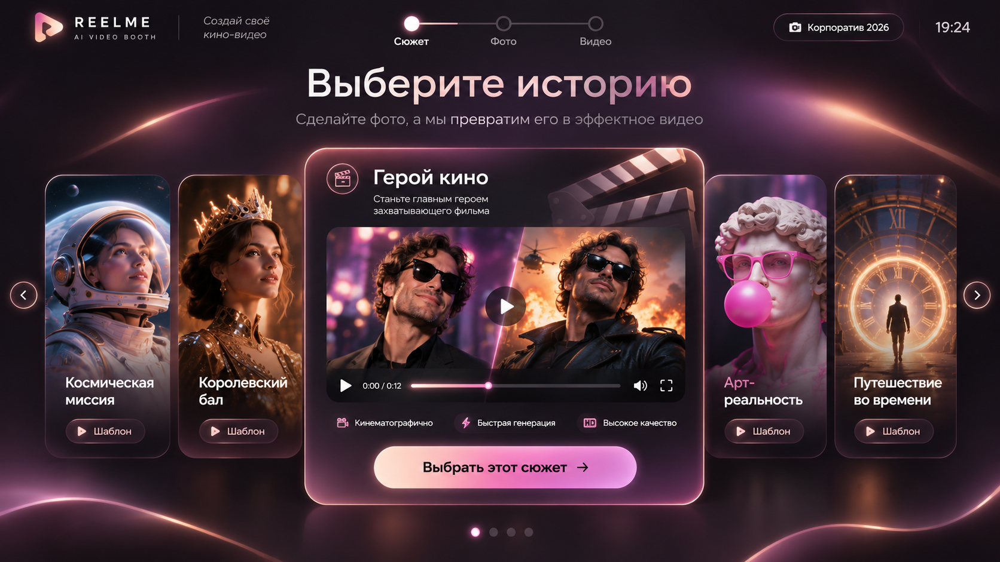
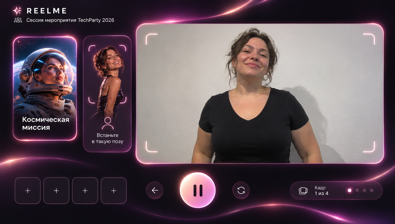

# 🎬 ReelMe

**Вы в главной роли.**

AI-фотобудка для корпоративов, вечеринок и других встреч. Гость выбирает сюжет, фотографируется и получает персональное видео — на память о вечере.

**🎭 Выберите историю → 📸 Сделайте фото → 💌 Заберите видео**

## 🎭 Какая история сегодня ваша?

Космическая миссия, королевский бал или роль в кино — листайте сюжеты и смотрите примеры перед съёмкой.

## 📸 Улыбнитесь. Дальше подскажем

Образец позы, зеркальное превью и отсчёт помогают подготовиться. Не понравился кадр? Его можно переснять. Нужна минутка? Поставьте съёмку на паузу.

## ✨ Что умеет ReelMe

- **🎞️ Создавать видео с гостями** — по фотографиям или на основе подготовленного ролика.
- **👥 Снимать одного, двоих или компанию** — с нужным числом кадров и подсказками для каждого шага.
- **🪄 Настраивать сюжеты под мероприятие** — изображения, примеры видео, модели и параметры в редакторе.
- **📺 Показывать готовые истории на общем экране** — с номером гостя и QR-кодом.
- **💌 Отдавать видео на телефон и по email** — чтобы сохранить себе или поделиться.
- **🗂️ Хранить историю мероприятий** — фотографии и результаты доступны в архиве.

Пока видео готовится, фотобудка уже может принимать следующего гостя. Никому не нужно стоять у камеры и ждать 💜

[Посмотреть сюжеты](https://reelme.natureonzoom.win/) · [Админка](https://reelme.natureonzoom.win/admin) · [Сегодня / Архив](https://reelme.natureonzoom.win/operator) · [Экран результатов](https://reelme.natureonzoom.win/results)

## 🛠️ Запустить у себя

**Svelte · TypeScript · Fastify · SQLite · fal · digiCamControl**

[Установка и работа с проектом](docs/MANUAL.md) · [Настройка сюжетов](docs/slot-setup/matrix.md) · [Развёртывание](deploy_to_nskserver.md)
